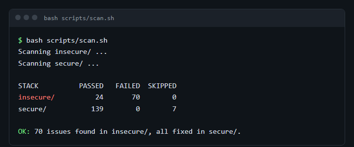
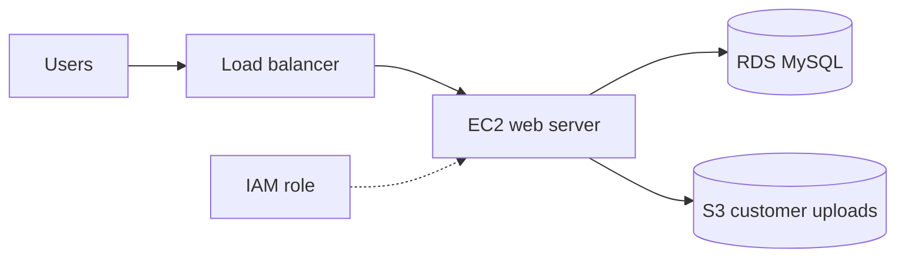

# ☁️ Cloud Security: Before vs After


An AWS account and the web app inside it, written twice in **Terraform**: once the way real breaches start,
and once locked down from scratch. MFA on everything, least privilege, nothing public.
An automated **Checkov** scan in **GitHub Actions** proves the difference on every push.



The project has two layers:

- **Account** ([`account.tf`](secure/account.tf)): who can sign in, how, and what gets logged. This is what you set up right after creating an AWS account.
- **Workload** ([`main.tf`](secure/main.tf)): a small web app (S3, EC2, RDS, IAM role) running inside that account.

> ⚠️ `insecure/` is **deliberately vulnerable** and exists only to be scanned.
> It has a built-in safety lock: `terraform plan` and `terraform apply` always fail on it.

## The task

> **Lock down a cloud account from scratch.** MFA on everything, least privilege, nothing public.
> Screenshot the before and after and write up what you changed and why.

| Requirement | Where it is |
|---|---|
| MFA on everything | No IAM users. Both roles can only be assumed with MFA used in the last hour (A1, A3). Root MFA is on the manual checklist. |
| Least privilege | Read-only role for daily work, separate break-glass admin, web server role limited to its own bucket and key (A2, A4, #7) |
| Nothing public | Account-wide S3 public access block, private EC2 and RDS, no SSH or RDP open (A6, #1, #5, #8, #12) |
| Before and after | `insecure/` vs `secure/`, scanned by Checkov on every push (screenshot above) |
| What changed and why | The two tables below, one row per change |


A typical small web application on AWS:



## Account: what was wrong and how it was fixed

| # | ❌ Insecure | Why it's dangerous | ✅ Secure fix | Checkov IDs |
|---|---|---|---|---|
| A1 | Shared `admin` IAM user with `AdministratorAccess` and a long-lived access key | One leaked key (laptop, public repo, CI log) is the whole account | **No IAM users at all.** People sign in through IAM Identity Center and assume a role | CKV_AWS_273, 274, 40 |
| A2 | `developer` user with an inline `Action: "*"` policy | Every developer is an admin | Everyday role gets **ReadOnlyAccess** only | CKV_AWS_62, 63, 286-290, 355, CKV2_AWS_40 |
| A3 | No MFA anywhere | A phished password is enough | Both roles can only be assumed **with MFA** used in the last hour, sessions max one hour | (trust policy) |
| A4 | Admin rights are always on | Mistakes and stolen sessions have full power | Separate **break-glass admin role** that raises an alarm every time it is used | CKV_AWS_274 (accepted, see below) |
| A5 | Password policy: 6 characters, no rules, reuse allowed | Easy to guess or reuse from other leaks | 14+ characters, all character types, no reuse of last 24, 90-day expiry | CKV_AWS_9-15 |
| A6 | Account-wide S3 public access block off | Any bucket can be made public by one bad policy | Public access blocked **for the whole account** | (account setting) |
| A7 | New EBS volumes unencrypted by default | Depends on people remembering | Encryption by default with our KMS key | CKV_AWS_106 |
| A8 | CloudTrail in one region, no validation, no encryption | Attacker activity in another region is invisible, logs can be edited | Multi-region trail, signed digest files, KMS, streamed to CloudWatch | CKV_AWS_35, 36, 67, 252, CKV2_AWS_10 |
| A9 | No alerting | Nobody finds out | CloudWatch alarms for **root usage**, **console login without MFA** and **break-glass use**, sent to an encrypted SNS topic | (CIS 4.x) |
| A10 | GuardDuty switched off | No threat detection at all | GuardDuty on, findings every 15 minutes | CKV_AWS_238 |
| A11 | Nothing checks for resources shared outside the account | Accidental sharing goes unnoticed | IAM Access Analyzer | (account setting) |

### Things Terraform cannot do

Some of the most important steps happen in the console. This is the checklist I follow for a new account:

- [ ] MFA on the **root user** (hardware key or authenticator app)
- [ ] Delete any **root access keys**
- [ ] Set **alternate contacts** (security, billing, operations)
- [ ] Turn on **IAM Identity Center** and create users there, with MFA required
- [ ] Subscribe an email address to the `security-alerts` SNS topic and confirm it
- [ ] Set a **budget alert**, so a hijacked account mining crypto is noticed quickly

## Workload: what was wrong and how it was fixed

| # | ❌ Insecure | Why it's dangerous | ✅ Secure fix | Checkov IDs |
|---|---|---|---|---|
| 1 | S3 bucket public, with a policy allowing `Principal: *` | Anyone can list and download all customer files, the cause of countless real data leaks | All 4 public access blocks on, HTTPS-only bucket policy | CKV_AWS_53-56, CKV2_AWS_6 |
| 2 | No S3 versioning | Deleted or ransomware-encrypted files are gone forever | Versioning + lifecycle rules | CKV_AWS_21, CKV2_AWS_61 |
| 3 | No customer-managed encryption | No control over who can decrypt the data | SSE-KMS with a rotating customer-managed key | CKV_AWS_145 |
| 4 | No S3 access logging | Impossible to investigate who accessed what | Access logs sent to a separate log bucket | CKV_AWS_18 |
| 5 | SSH (22) and RDP (3389) open to `0.0.0.0/0` | Bots start brute-forcing within minutes | No admin ports at all. Access goes through **SSM Session Manager** | CKV_AWS_24, CKV_AWS_25 |
| 6 | All outbound traffic allowed | Makes data exfiltration and malware callbacks easy | Only HTTPS out, and MySQL only inside the VPC | CKV_AWS_382 |
| 7 | IAM policy `Action: "*"`, `Resource: "*"` | A hacked web server means a hacked AWS account | **Least privilege**: only its own bucket and key | CKV_AWS_62, 63, 286-290, 355, CKV2_AWS_40 |
| 8 | EC2 has a public IP | Server is directly exposed to the internet | Private subnet behind the load balancer | CKV_AWS_88 |
| 9 | IMDSv1 enabled | SSRF can steal instance credentials ([Capital One 2019](https://krebsonsecurity.com/2019/08/what-we-can-learn-from-the-capital-one-hack/)) | IMDSv2 required, hop limit 1 | CKV_AWS_79 |
| 10 | Unencrypted EBS disk | Snapshots and disks can be read if leaked | Encrypted with KMS | CKV_AWS_8 |
| 11 | Passwords and API keys hardcoded in code | Secrets stay in Git history forever | AWS-managed password in **Secrets Manager** | CKV_SECRET_6 |
| 12 | RDS publicly accessible | Database reachable from the internet | Private only, reachable from the web SG only | CKV_AWS_17 |
| 13 | RDS unencrypted | Data at rest can be exposed | Encrypted with KMS | CKV_AWS_16 |
| 14 | No backups, no deletion protection, single AZ | One mistake or outage loses everything | 7-day backups, deletion protection, Multi-AZ | CKV_AWS_133, 293, 157 |
| 15 | No database logs or monitoring | Attacks go unnoticed | Audit logs to CloudWatch, enhanced monitoring, IAM auth | CKV_AWS_129, 118, 161 |

## Accepted risks (skipped checks)

Real security work is not about reaching zero warnings at any cost. It is about making **conscious,
documented decisions**. Seven checks are skipped in `secure/`, each with a written reason next to it:

| Check | Reason |
|---|---|
| CKV_AWS_144 (×2) cross-region replication | Disaster-recovery choice with extra cost, out of scope for this demo |
| CKV2_AWS_62 (×2) S3 event notifications | No downstream system needs them |
| CKV_AWS_18 on the log bucket | It *is* the log bucket; logging it into itself would loop |
| CKV_AWS_274 on the break-glass role | Someone must be able to fix things in an emergency. The role needs MFA, lasts one hour and triggers an alarm on every use |
| CKV2_AWS_3 GuardDuty org config | Single account, not part of an AWS Organization, so there is no org-wide setting to configure |

## How the CI pipeline works

Every push runs [`.github/workflows/security-scan.yml`](.github/workflows/security-scan.yml):

1. **Terraform format & validate**: both stacks must be well-formed.
2. **Checkov scan** via [`scripts/scan.sh`](scripts/scan.sh). The build fails if:
   - `secure/` has **any** failed check (a regression was introduced), or
   - `insecure/` has **zero** failed checks (the scanner stopped catching the planted issues).

The results table is posted to the Actions **job summary** page.

## Run it yourself

No AWS account is needed. Nothing is deployed, the code is only scanned.

```bash
git clone https://github.com/t4lh8/Cloud-Security-Before-After.git
cd Cloud-Security-Before-After
pip install checkov

checkov -d insecure        # see every issue in detail
checkov -d secure          # all passing
bash scripts/scan.sh       # side-by-side comparison
```

## Project structure

```
├── insecure/                # ❌ vulnerable stack (scan only, never deploy)
│   ├── account.tf           #    account settings
│   ├── main.tf              #    web app workload
│   └── variables.tf
├── secure/                  # ✅ hardened stack
│   ├── account.tf
│   ├── main.tf
│   └── variables.tf
├── docs/scan-output.png     # real output of scripts/scan.sh
├── scripts/scan.sh          # before/after comparison + CI gate
└── .github/workflows/
    └── security-scan.yml    # GitHub Actions pipeline
```

## What I learned

- Writing AWS infrastructure as code with **Terraform**
- The most common cloud misconfigurations behind real breaches: public buckets, open ports, over-privileged IAM, IMDSv1 and hardcoded secrets
- **Defense in depth**: network isolation, least privilege, encryption, logging and backups working together
- **Policy-as-code** scanning with Checkov and shifting security left into **CI/CD**
- Documenting **risk acceptance** instead of blindly silencing warnings
- Locking down an account before anything runs in it: no IAM users, MFA-only roles, multi-region CloudTrail and alarms on root use

## What surprised me

- The account layer added 29 findings, and almost all of them were about **people and logging**, not about servers. The most dangerous thing in the insecure version is one IAM user with an access key.
- Encrypting CloudTrail and CloudWatch Logs with my own KMS key broke nothing in `terraform validate`, but it would fail at deploy time without extra key policy statements for the CloudTrail and CloudWatch Logs services. A scanner that says "use a CMK" does not tell you that.
- Root MFA, the single most important setting, cannot be set from Terraform at all.

## What I'd do differently

- Deploy it once to a real test account and include console screenshots of the MFA prompt, GuardDuty and a triggered alarm. Right now the proof is the scan, not a running account.
- Move the account layer into an AWS Organization with SCPs (for example "deny leaving the organization" and "deny disabling CloudTrail"), which a single account cannot enforce on itself.
- Add `terraform plan` against a real account in CI with OIDC instead of only `validate`.

## License

[MIT](LICENSE)

Made by Talha Aker.
